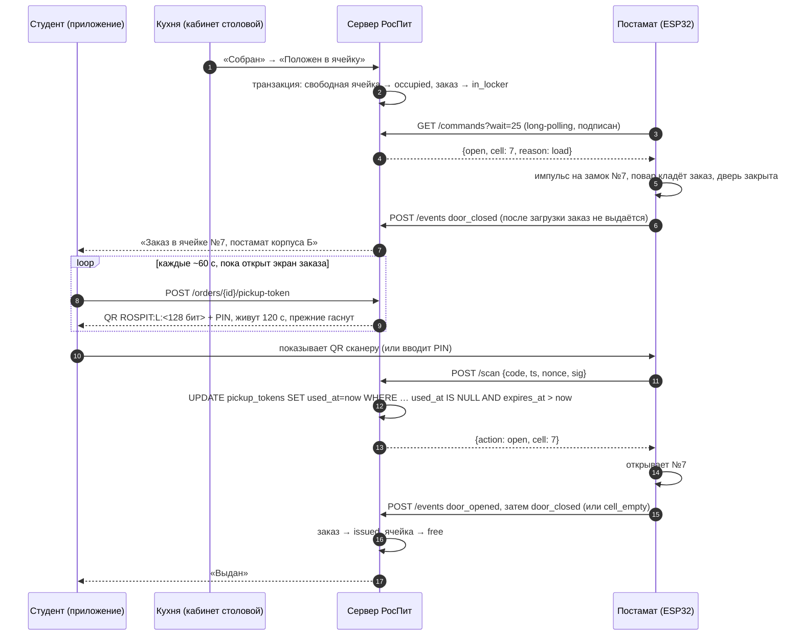

# Постамат РосПит: ячейки, одноразовый QR и связь с ESP32

Документ для разработчика, который будет собирать прототип постамата.
Серверная часть сделана и покрыта тестами (`tests/test_locker.py`), весь сценарий можно
показать без железа эмулятором `scripts/locker_simulator.py`. Прошивка
`firmware/esp32_locker/` — **черновик, на железе не проверялся**.

## 1. Что происходит с заказом



Статусы заказа: `paid → (accepted → cooking) → ready → in_locker → issued`.
Шаги в скобках необязательны. Состояния ячейки: `free / reserved / occupied / out_of_service`.

## 2. API устройства

Отдельный роутер `app/routers/locker_device.py`, без JWT пользователя. Устройство
идентифицируется `device_id` в адресе и подписью запроса.

**Подпись.** `sig = HMAC-SHA256(device_secret, "device_id|ts|nonce|payload")` в hex.

| Поле | Что это |
|------|---------|
| `ts` | Unix-время UTC в секундах (ESP32 берёт по NTP) |
| `nonce` | случайная строка 8–64 символа, каждый раз новая |
| `payload` | зависит от метода, см. ниже |

Сервер отклоняет: неверную подпись (`401 bad_signature`), запрос старше или «младше»
30 с (`401 stale_request`, настройка `DEVICE_CLOCK_SKEW_SECONDS`), повтор nonce
(`409 replayed_nonce`), неизвестное устройство (`404`).

| Метод | payload для подписи | Тело / ответ |
|-------|--------------------|--------------|
| `POST /api/device/lockers/{device_id}/scan` | значение `code` | `{code, ts, nonce, sig}` → `{action:"open", cell:7, order:"RP-1234"}` или `{action:"deny", reason, message}` |
| `POST /api/device/lockers/{device_id}/events` | `"<type>:<cell>"` | `{type, cell, empty?, ts, nonce, sig}` → `{ok, issued}` |
| `POST /api/device/lockers/{device_id}/heartbeat` | `"heartbeat"` | `{firmware, ts, nonce, sig}` → `{ok}` |
| `GET /api/device/lockers/{device_id}/commands?ts&nonce&sig&wait=25` | `"commands"` | → `{commands:[{id, action:"open", cell, reason}]}` |

`type` события: `door_opened`, `door_closed`, `cell_empty` (датчик), `door_jammed`.
`reason` отказа: `expired`, `used`, `unknown_code`, `other_locker`, `not_in_locker`,
`too_many_attempts`, `window_code`.

Каждый подписанный запрос обновляет `last_seen_at`; в кабинете столовой постамат
отмечается «онлайн», если запрос был за последние 90 с (`LOCKER_ONLINE_SECONDS`).

Секрет устройства для прошивки: `python scripts/locker_simulator.py --device locker-b1 secret`
(на сервере с боевым `SECRET_KEY`). Секрет выводится из `SECRET_KEY` и `Locker.key_version`,
в базе хранится только хэш — HMAC проверяется знающим секрет, хранить его открыто не нужно.
Смена ключа: увеличить `key_version`, прошить новый секрет.

### Long-polling или MQTT

Для MVP выбран long-polling: обычный HTTPS через тот же Caddy, ничего не надо поднимать,
устройство само ходит наружу (не нужен белый IP и проброс портов в сети вуза).
Задержка команды — до секунды, этого достаточно для «открыть ячейку повару».

Переходить на **MQTT (Mosquitto + TLS, у каждого постамата свой логин и ACL на свои топики)**,
когда:
- постаматов больше 3–5 — держать по открытому HTTP-запросу на каждое устройство дороже,
  чем одно MQTT-соединение;
- нужна телеметрия в реальном времени (температура, ток замков, состояние каждой двери);
- нужен `last will` — мгновенно узнавать о пропаже связи, а не через 90 с;
- сеть нестабильна и важны QoS 1 и сохранённые сессии.

Протокол сообщений при этом не меняется: те же JSON и та же подпись поверх топиков
`rospit/lockers/<id>/scan`, `/events`, `/commands`.

## 3. Безопасность: почему HMAC и одноразовый токен, а не номер заказа в QR

- **Номер заказа угадывается.** `RP-1234` — четыре цифры. Если бы постамат открывался
  по номеру, любой перебрал бы ячейки за минуту. В QR лежит `ROSPIT:L:<token>` —
  128 бит случайности (`secrets.token_urlsafe(16)`), подобрать нельзя.
- **В базе только хэш токена.** Утечка базы не даёт кодов, которыми можно открыть ячейки.
- **Токен живёт 120 с и гаснет при выпуске нового.** Экран заказа берёт новый код каждые
  ~60 с. Скриншот, пересланный другу, через пару минут бесполезен.
- **Использование атомарное.** `UPDATE … SET used_at = now() WHERE token_hash = ? AND
  used_at IS NULL AND expires_at > now()` — из двух одновременных сканов одного кода проходит
  ровно один (тест `test_parallel_scans_open_once`). После открытия гаснут и остальные коды
  заказа, включая PIN.
- **PIN — запасной вариант без камеры.** 6 цифр, тот же срок жизни и одноразовость; хэш PIN
  привязан к постамату и `SECRET_KEY`. Не больше 5 неверных PIN за 5 минут на устройство
  (`PIN_ATTEMPTS_PER_5MIN`), дальше отказ `too_many_attempts` — QR при этом работает.
- **Запросы устройства подписаны.** Без секрета нельзя ни открыть ячейку, ни отметить
  заказ выданным. Отметка времени и nonce защищают от повтора перехваченного запроса.
- **HTTPS с проверкой сертификата на ESP32** (`setCACert`, никогда `setInsecure`) —
  иначе подменённая точка доступа ответит устройству `{action:"open"}`.
- **Без сети замки не открываются.** Проверить одноразовый код офлайн нельзя; на дисплее —
  «Нет связи, обратитесь в окно выдачи».
- Окно выдачи по-прежнему принимает подписанный статичный код `ROSPIT:<номер>:…`, но
  только один раз: после `issued` повторно не принимается (тесты в `test_flow.py` и `test_brand.py`).
  У постамата такой код отклоняется с подсказкой открыть заказ в приложении.

## 4. Нештатные сценарии

| Ситуация | Что происходит | Что делает человек |
|----------|----------------|--------------------|
| **Не забрал до конца дня** | Заказ висит в `in_locker`, ячейка занята | Оператор в кабинете → «Забрать из ячейки»: сервер шлёт команду открыть ячейку, заказ возвращается в `ready` у окна выдачи и выдаётся по номеру. Порядок возврата денег за невостребованное — решение столовой |
| **Ячейка не открылась** после `open` | Устройство шлёт `door_jammed`, дверь не открывалась — заказ не выдан | Студент идёт в окно; оператор находит заказ по номеру и выдаёт («Выдать заказ» освобождает ячейку и шлёт команду открыть её для выемки). Ячейку — «на обслуживание» (`out_of_service`), чтобы туда не клали |
| **Потерялась связь** | Постамат «не на связи» в кабинете через 90 с; замки не открываются; дисплей отправляет в окно | Кухня не кладёт новые заказы в постамат и выдаёт в окне; уже положенные достаёт ключом/сервисной кнопкой |
| **Нет свободных ячеек** | «Положен в ячейку» → `409 нет свободных ячеек` | Заказ выдаётся в окне по QR или номеру |
| **Отмена заказа, лежащего в ячейке** | Ячейка освобождается, уходит команда открыть её | Повар забирает заказ |
| **Два повара жмут одновременно** | Ячейка захватывается условным `UPDATE … WHERE state='free'` (+ `FOR UPDATE SKIP LOCKED` на PostgreSQL) — одна ячейка не достанется двум заказам | — |

## 5. Железо для прототипа

> Цены ориентировочные (розница РФ, осень 2026) и **требуют проверки** перед закупкой.

**Стенд на 1 ячейку** — проверить протокол, сканер и замок:

| Компонент | Кол-во | Примерно, ₽ |
|-----------|--------|-------------|
| ESP32-DevKitC (ESP32-WROOM-32) | 1 | 700–1 000 |
| QR-сканер GM65 или GM805 (UART, 5 В) | 1 | 2 500–4 000 |
| Электромеханический замок 12 В (соленоид, «язычок») | 1 | 500–900 |
| Модуль реле 1 кан. или MOSFET-модуль IRF520 + диод | 1 | 150–300 |
| Геркон с магнитом | 1 | 100–250 |
| Блок питания 12 В 2 А + DC-DC 12→5 В | 1 | 700–1 200 |
| Клавиатура 4×3, дисплей LCD 1602 I2C | 1+1 | 500–800 |
| Макетная плата, провода, корпус-коробка | — | 800–1 500 |
| **Итого** | | **≈ 6 000–10 000** |

**Постамат на 24 ячейки:**

| Компонент | Кол-во | Примерно, ₽ |
|-----------|--------|-------------|
| ESP32-DevKitC | 1 (+1 запасной) | 1 400–2 000 |
| QR-сканер встраиваемый GM65/GM805 | 1 | 2 500–4 000 |
| Замки 12 В | 24 | 12 000–22 000 |
| Расширители MCP23017 (выходы и входы) | 4 | 1 000–1 600 |
| Модули реле 16 кан. 12 В (или плата MOSFET) | 2 | 2 500–4 000 |
| Герконы | 24 | 2 500–6 000 |
| Блок питания 12 В 10 А, DC-DC, предохранители | 1 | 2 500–4 500 |
| Дисплей с кириллицей (OLED 1,3″ или TFT 2,8″), клавиатура | 1 | 800–2 000 |
| Металлический шкаф 24 ячейки (камера хранения) | 1 | 60 000–150 000 |
| ИБП 12 В / аккумулятор на 1–2 ч | 1 | 3 000–6 000 |
| **Итого без шкафа** | | **≈ 30 000–55 000** |
| **Итого со шкафом** | | **≈ 90 000–200 000** |

Отдельно стоит обсудить с вузом: место установки, розетку и Wi-Fi (или проводной Ethernet
через W5500 — надёжнее в здании), пожарные требования к шкафу, кто обслуживает и у кого
механический ключ. Для горячих блюд нужны термоизолированные ячейки или ограничение по времени
хранения — это вопрос к столовой и СанПиН.

## 6. Как показать без железа

```bash
uvicorn app.main:app --reload        # сервер
python scripts/locker_simulator.py demo
```

Эмулятор подписывает запросы как ESP32: оформляет заказ на перемену с постаматом, кухня кладёт
его в ячейку, постамат получает команду, студент получает одноразовый QR, «сканер» открывает
ячейку, повторный скан того же кода получает отказ, после закрытия двери заказ «Выдан».
Параллельно можно держать открытыми экран студента и кабинет столовой — статусы обновятся сами.
