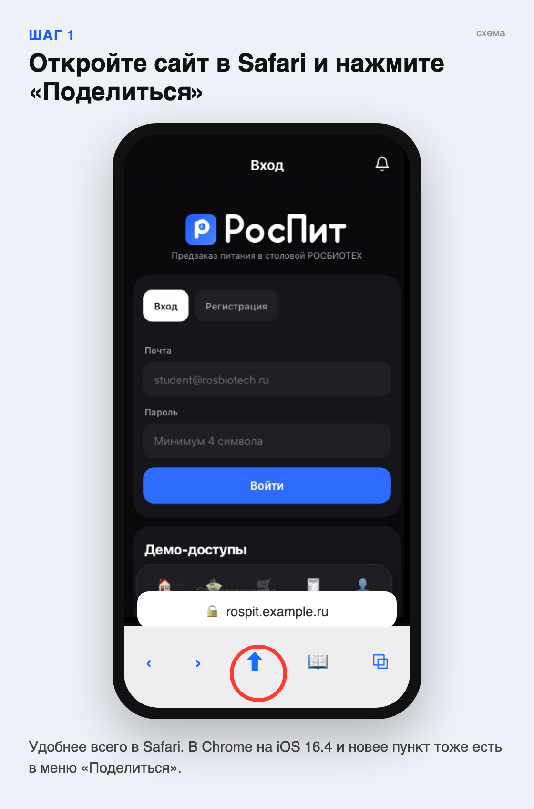
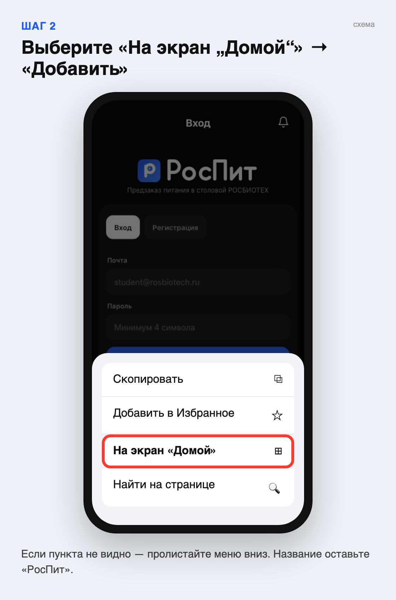
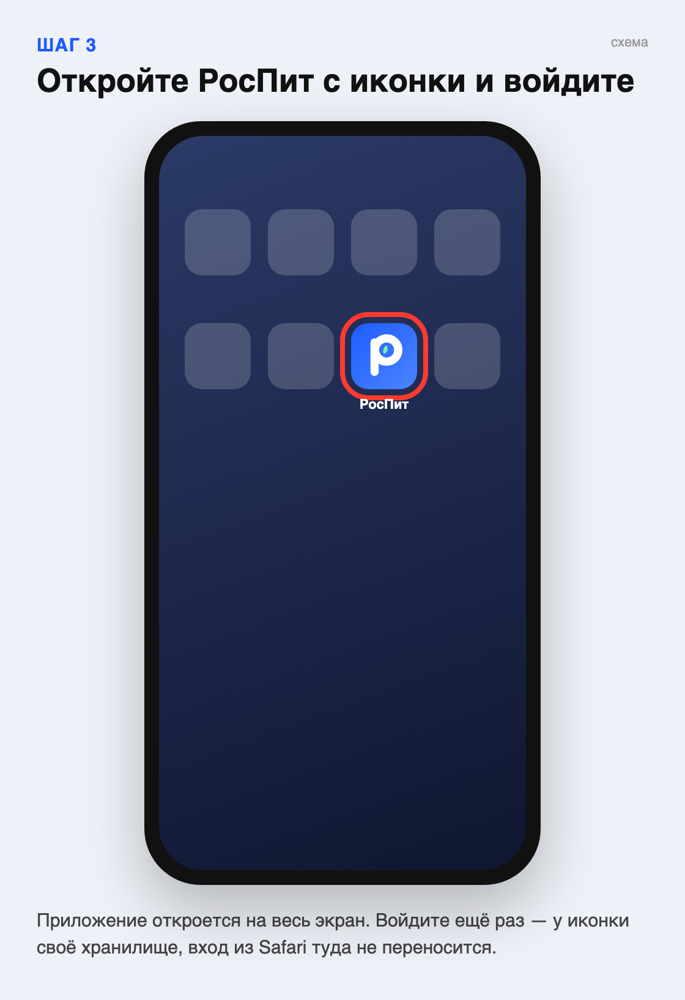

# РосПит на iPhone — в 3 шага

Для студентов. Приложение не нужно скачивать из App Store: его ставят прямо с сайта,
и оно открывается с иконки как обычное приложение.

**Адрес:** `https://rospit.<домен>` (подставить настоящий после запуска сервера).

**1. Откройте адрес в Safari и нажмите «Поделиться»** — квадрат со стрелкой внизу экрана.

**2. Выберите «На экран „Домой“» и нажмите «Добавить».** Если пункта не видно — пролистайте меню.

**3. Откройте РосПит с иконки и войдите** своей почтой и паролем.

Важно знать:

- Войти нужно ещё раз — у приложения на домашнем экране своё хранилище, вход из Safari туда не переносится.
- Нужен iOS 16.4 или новее (Настройки → Основные → Об этом устройстве).
- Android: в Chrome откройте адрес → меню ⋮ → «Установить приложение» (или установите APK, если его прислали).

Картинки — схемы: панель Safari и меню нарисованы упрощённо, на вашем iPhone они могут выглядеть чуть иначе.
